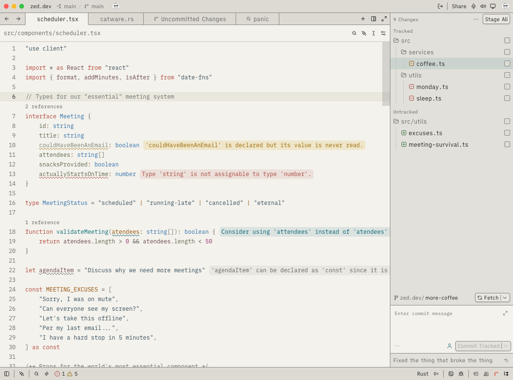
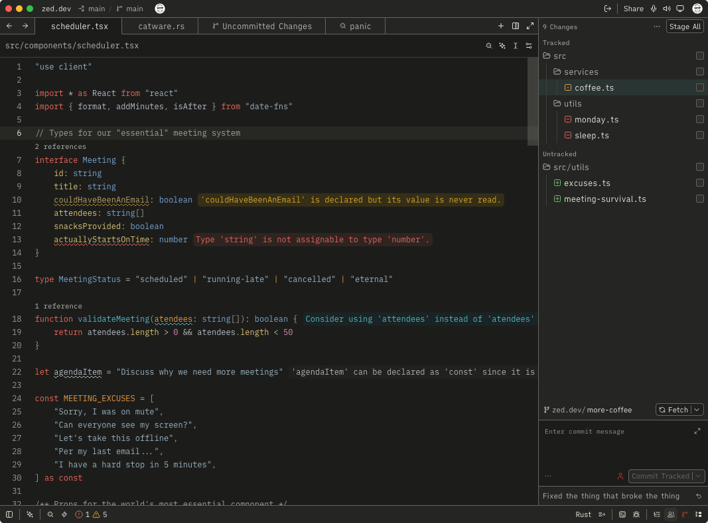

# L10 Instrument

Warm materials. Purposeful colour.

L10 Instrument provides light and dark themes for Zed, VS Code, Ghostty, iTerm2
and the web. This is a personal project. The GitHub repository and Pages preview
are public; the themes are not submitted to extension stores or theme repositories.

| Light in Zed                                                   | Dark in Zed                                                  |
| -------------------------------------------------------------- | ------------------------------------------------------------ |
|  |  |

## Build

Use Node.js 26 or newer. `.nvmrc` selects Node.js 26.

```sh
npm ci
npm run build
npm run lint
npm run check
```

Use `npm run fix` to apply ESLint fixes and format supported files.

Open `index.html` to compare the light and dark themes after `npm run build`.
The preview loads its generated token CSS, so it checks the CSS export as well as
the resolved theme data.
The preview includes code samples, token examples and colour tables.

| Output                  | Location                                 |
| ----------------------- | ---------------------------------------- |
| Zed theme extension     | `extensions/zed/`                        |
| VS Code theme extension | `extensions/vscode/`                     |
| Ghostty themes          | `dist/ghostty/`                          |
| iTerm2 themes           | `dist/iterm/*.itermcolors`               |
| Resolved tokens         | `dist/tokens/tokens.json`                |
| CSS custom properties   | `dist/tokens/tokens.css`                 |
| Local preview           | `index.html`                             |
| Website and downloads   | `dist/site/` after `npm run build:pages` |

Commit the generated editor themes with their extension manifests.
Do not edit generated files. Git ignores `index.html` and `dist/`.
Build commands do not install or publish themes.

## Local use

### Zed

1. Select **Install Dev Extension** in Zed.
2. Select the `extensions/zed/` directory.
3. Select **L10 Instrument Light** or **L10 Instrument Dark** in the theme selector.

To install the theme without the extension, copy
`extensions/zed/themes/l10-instrument.json` to
`~/.config/zed/themes/`.

### VS Code

Run this command from the repository root to open an Extension Development Host:

```sh
code --new-window --extensionDevelopmentPath="$PWD/extensions/vscode"
```

Select **Preferences: Color Theme**. Then select **L10 Instrument Light** or
**L10 Instrument Dark**.

To keep the themes available in normal VS Code windows:

1. Copy `extensions/vscode/` to `~/.vscode/extensions/l10-local.l10-instrument-vscode-theme-0.0.2/`.
2. Reload VS Code.

Copy the directory again after each build.
The manifest uses `l10-local` as a local publisher ID.

### Ghostty

Create `$XDG_CONFIG_HOME/ghostty/themes/` if the directory does not exist.
The usual location is `~/.config/ghostty/themes/`.
Copy both files from `dist/ghostty/` to this directory.
Add this line to the Ghostty configuration:

```ini
theme = dark:L10 Instrument Dark,light:L10 Instrument Light
```

Reload the Ghostty configuration.
The theme files set colours only. They do not change fonts, key bindings or
shell commands.

### iTerm2

1. Open **Settings > Profiles > Colors > Color Presets > Import**.
2. Select the files in `dist/iterm/`.
3. Select **L10 Instrument Light** or **L10 Instrument Dark** from Color Presets.

Both terminal formats use the same palette.
Edit `design-system/terminal.json` to change the token mappings.

### HTML / React

Copy `dist/tokens/tokens.css` into your website. Load it with a stylesheet link
or your existing bundler:

```tsx
import "./tokens.css";
```

```css
.instrument {
  background: var(--l10-surface-canvas);
  color: var(--l10-text-primary);
  border: 1px solid var(--l10-border);
}
```

The CSS selects the theme from the system appearance.
Set `data-l10-theme="light"` or `data-l10-theme="dark"` on `<html>` to select a
theme manually.
Use the same attribute on an element to set the theme for that element and its
children. Remove the attribute to use the parent theme or system appearance.

Typography tokens include `--l10-weight-structure`.
The CSS does not set fonts.

The CSS export contains semantic roles and typography tokens.
Property names start with `--l10-`. Dots and underscores become hyphens.
The CSS export does not include palette anchors.

Use `tokens.json` in JavaScript or other tools.
It contains resolved token dictionaries: `typography`, `grid`, `modes.light`
and `modes.dark`. Each token has a type and a value.
Colours use sRGB hex values:

```js
const foreground = tokens.modes.light["text.primary"].value;
```

The JSON uses a project-specific format, not the DTCG format.
The CSS and JSON exports do not require an editor.

## Colour language

| Colour | Role                         |
| ------ | ---------------------------- |
| Blue   | Types and structure          |
| Petrol | Functions and behaviour      |
| Coral  | Language and control flow    |
| Ochre  | Parameters and inputs        |
| Sage   | Properties and attributes    |
| Ink    | Strings and written data     |
| Violet | Numbers and booleans         |
| Grey   | Comments and supporting text |

Comments use opaque grey. JSDoc annotations use less prominent forms of the code
colours. Light and dark themes have separate colour definitions.
Contrast adjustments use palette derivations, not separate hex values.

Regression checks require a contrast ratio of at least 4.5:1 for these colours:

- Configured source-code colours, including comments and JSDoc, on the editor background.
- All 16 ANSI foreground colours on the terminal background.

The checks do not cover other backgrounds, inverse video or dimmed text.
They do not cover every interface state.

## Development

Follow **palette -> semantic role -> target mapping**.

| Source                                                                         | Responsibility                                                          |
| ------------------------------------------------------------------------------ | ----------------------------------------------------------------------- |
| `design-system/tokens.json`                                                    | OKLCH anchors, semantic roles, derivations, typography and preview grid |
| `design-system/zed.json`                                                       | Zed UI and syntax captures                                              |
| `design-system/vscode.json`                                                    | Workbench colours, TextMate scopes and semantic tokens                  |
| `design-system/terminal.json`                                                  | Shared terminal colours and ordered ANSI palette                        |
| `scripts/tokens.ts`, `scripts/colors.ts`                                       | Shared validation and colour resolution                                 |
| `scripts/zed.ts`, `scripts/vscode.ts`, `scripts/terminal.ts`, `scripts/web.ts` | Theme and token exporters                                               |
| `scripts/build.ts`                                                             | Build inputs and outputs                                                |
| `scripts/preview.ts`                                                           | Generated HTML preview                                                  |

Each exporter receives resolved tokens. It does not read another exporter's output.
The terminal exporter produces both Ghostty and iTerm2 files.

To add an output format:

1. Add the token mapping and exporter.
2. Add the exporter to `scripts/build.ts`.
3. Add a regression check.

| Command         | Checks                                                                        |
| --------------- | ----------------------------------------------------------------------------- |
| `npm run lint`  | ESLint rules and Prettier formatting                                          |
| `npm run fix`   | Apply safe ESLint fixes and format supported files                            |
| `npm run check` | Lint, TypeScript types, regression tests and generated editor theme freshness |
| `npm test`      | Regression tests only                                                         |

Zed validation uses a local copy of the official schema.
VS Code and terminal validation use local rules.
Ignored output files do not need to exist before you run `npm run check`.
Builds work offline after `npm ci`.

Check both themes in each editor.
Inspect TypeScript, JSDoc, Markdown and embedded-language highlighting.
In VS Code, use **Developer: Inspect Editor Tokens and Scopes** to check TextMate
scopes and semantic tokens.
VS Code supports normal and bold syntax weights. Zed supports numeric weights.

### Preview

The preview shows both code samples first.
Token examples, terminal palettes and mapping tables follow.
The samples use fixed syntax labels, not an editor highlighting engine.
The TypeScript sample uses Zed mappings.
Check actual highlighting in each editor.

Run `npm run build:pages` to create the website in `dist/site/`.
This directory includes fonts, licence notices and theme downloads.
GitHub Actions checks changes and deploys the website from `main` to GitHub Pages.
It does not publish extensions.

## Social responsibility

Build tools that help people. Respect privacy, support accessibility and consider
the effects of your work on people and the environment.
Do not use this work to harm, exploit or discriminate against others.

This statement expresses the project's values. It does not add restrictions to
the MIT licence.

## Credits and licence

An LLM assisted with the theme and build tools.
The project uses the [MIT licence](LICENSE).
Each editor extension includes a copy.
The preview includes [Fira Code](https://github.com/tonsky/FiraCode) and
[IBM Plex Sans](https://github.com/IBM/plex) under the SIL Open Font License.
Their licence notices are in `assets/fonts/` and the Pages output.
